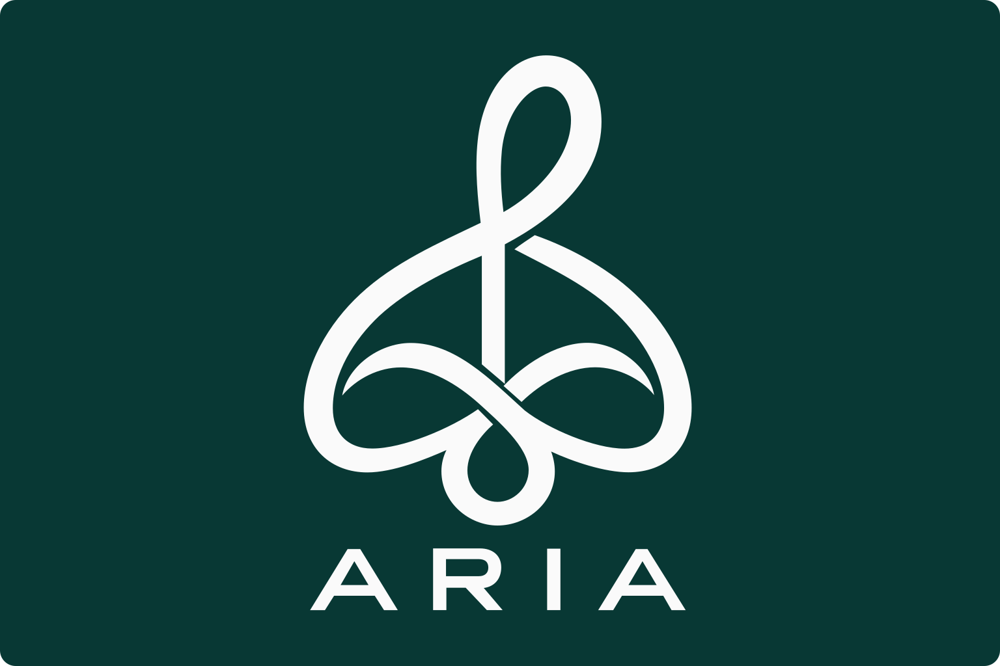

<p align="center">
  <picture>
    <source media="(prefers-color-scheme: dark)" srcset="assets/aria-banner-dark.svg">
    <source media="(prefers-color-scheme: light)" srcset="assets/aria-banner-light.svg">
    
  </picture>
</p>

<p align="center">
  <a href="https://huggingface.co/zerak12/aria-3b-gguf"></a>
  <a href="https://huggingface.co/zerak12/aria-3b-lora"></a>
  <a href="docs/aria_academic_paper.pdf"></a>
  <a href="tests/"></a>
  <a href="LICENSE"></a>
</p>

---

## Overview

**Aria** is an edge-native, sovereign personal AI companion and sandboxed terminal agent fine-tuned from `Qwen2.5-3B-Instruct` for local execution on consumer edge hardware (NVIDIA GeForce GTX 1650 Mobile, 4,096 MiB VRAM) with zero cloud data egress.

Aria unifies **Dual-Mode Intent Routing** (empathetic conversational companion $\leftrightarrow$ authoritative systems engineer) with **Zero-Copy In-Memory Tensor Fusion** and a deterministic **4-Tier Safe Execution Sandbox**.

---

## Quickstart

### Run with Ollama

```bash
ollama run hf.co/zerak12/aria-3b-gguf:aria_q4.gguf
```

### Build Locally

```bash
git clone https://github.com/zerakjamil/aria.git
cd aria
ollama create aria:3b -f models/Modelfile.aria
ollama run aria:3b
```

### Development & Invariants Test Harness

```bash
python3 -m venv .venv && source .venv/bin/activate
pip install -r requirements.txt
pytest tests/ -v
```

---

## Empirical Benchmarks & Hardware Envelopes

| Metric / Benchmark | Result | Environment / Method |
| :--- | :--- | :--- |
| **Phase 10 GRPO & RLVR Loss** | **0.7004** (Final step 753 / 753) | 557 Fused Samples · 753 Steps · 3 Epochs |
| **Phase 10 Mean Token Accuracy** | **84.67% – 85.12%** | Cosine Annealing Decay · RAM Layer Streaming |
| **Edge Hardware Serving Envelope** | **1,436 MiB VRAM · 28.6–40.1 tok/s** | NVIDIA GTX 1650 Mobile (4,096 MiB physical capacity) |
| **System Invariant & Test Suite** | **109 / 109 Passed (100%) in 3.15s** | 48 Invariants + 10 Counterfactual + 8 Harness + RLVR |
| **RLVR Verification Challenge Bank** | **40 Rigorous Challenges** | Algorithmic Invariants, Linux Systems, Counterfactuals |
| **Group Relative Policy Optimization** | **$G=4, \hat{A}_i \in [-1.73, +1.73]$** | Contrastive Filtering ($\sigma_R > 0$) · $T=0.7$ Rollouts |
| **Reflexion Execution-Guided Repair** | **55.0% Pass Rate · 40.0% Recovery** | +30.0% Absolute Gain over Single-Shot via Diagnostics |
| **Zero-Copy Adapter Fusion** | **6.2–7.8 seconds** | Custom C++17 OpenMP `llama-export-lora` Binary |

---

## Core Architecture

- **On-Device GRPO & RLVR Engine (`grpo_self_evolution.py`):**
  - **Verifiable Reward Formulation:** Evaluates candidate solutions in an isolated execution sandbox against ground-truth unit assertions, assigning graduated rewards: $R = R_{\text{exec}} + R_{\text{scratchpad}} + R_{\text{efficiency}} - R_{\text{timeout}}$.
  - **Group Relative Advantage Normalization:** Groups of size $G=4$ are evaluated with normalized advantage $\hat{A}_i = \frac{r_i - \bar{r}}{\sigma_r + 10^{-4}}$, filtering strictly for contrastive groups ($\sigma_R > 0$) to reinforce high-advantage reasoning paths without a critic network.
  - **Traceback-Distilled Self-Repair Recovery:** When a rollout candidate fails ($0/G$), `TracebackDistiller` extracts localized traceback frames and triggers bounded Reflexion self-repair to turn horizon failures into verified golden trajectories.
- **Dual-Mode Behavioral Intent Routing:**
  - **Mode 1 (Empathetic Companion):** Emotional support, healthy rest validation, and startup founder reassurance with strictly bounded 3-sentence outputs and single-question conversational discipline.
  - **Mode 2 (Systems Engineer & Copilot):** Authoritative, zero-preamble code blocks, Linux command triage, and stack trace diagnosis with low-temperature deterministic sampling ($T=0.2$).
- **Counterfactual World Model (`counterfactual_engine.py`):**
  - First-order perturbation formula ($Y(A_{\text{alt}}) \approx Y(A_{\text{fact}}) + [P(A_{\text{alt}}) - P(A_{\text{fact}})]$) predicting environmental disturbances, filesystem permissions, socket collision, and resource exhaustions before execution with 0 parameter / 0 VRAM overhead.
- **Self-Improving Agent Harness (`self_improving_harness.py`):**
  - 4-component cognitive architecture (`CONTEXT_MEMORY`, `AGENT_CONTROL`, `ACTION_INTERFACE`, `VERIFICATION_RECOVERY`) with an automated invariant gate preventing non-monotonic regressions during self-directed updates.
- **Dynamic Persona Fluidity Engine:** Deterministically compiles custom identity attributes (Gender, Name, Age, Relational Archetype e.g. brother, sister, peer mentor) while preserving empathy, constitutional boundaries, and crisis quarantine invariants.
- **4-Tier Safe Execution Sandbox (ADR-005):** Deterministic AST blast-radius gating (Tier 0 Vitals $\to$ Tier 1 Workspace Mutation $\to$ Tier 2 Controlled System Ops $\to$ Tier 3 Hard-Blocked Destructive Commands rejected in 0.02ms).
- **Self-Healing Reflexion Diagnostic Loop:** Intercepts runtime errors (`exit != 0`), parses stderr diagnostics, and automatically synthesizes targeted remediation commands.
- **Crisis Quarantine Gate:** Deterministically redirects self-harm or acute distress indicators to verified 24/7 Lifeline resources (988), immediately quarantining the turn from episodic memory.

---

## Research Publication & Documentation

- **Full Academic Paper (PDF):** [`docs/aria_academic_paper.pdf`](docs/aria_academic_paper.pdf)
- **Interactive Defense Slides:** [`docs/presentation/index.html`](docs/presentation/index.html) ([Live GitHub Pages / Standalone](docs/presentation/index.html))
- **Defense Slides (PDF):** [`docs/presentation/aria_presentation.pdf`](docs/presentation/aria_presentation.pdf)
- **LaTeX Source:** [`docs/aria_academic_paper.tex`](docs/aria_academic_paper.tex)
- **Postman API Collection:** [`docs/Aria_AI_Companion.postman_collection.json`](docs/Aria_AI_Companion.postman_collection.json)

```bibtex
@article{jamil2026aria,
  title   = {Sovereign Edge AI Personal Companions: Empirical Architecture, Zero-Copy Quantized Adapter Fusion, and Sandboxed Dual-Mode Terminal Agency},
  author  = {Jamil, Zerak},
  journal = {Department of Information System Engineering, Erbil Polytechnic University},
  year    = {2026},
  url     = {https://github.com/zerakjamil/aria}
}
```

---

## License

Apache License 2.0. Built by Zerak Jamil.
