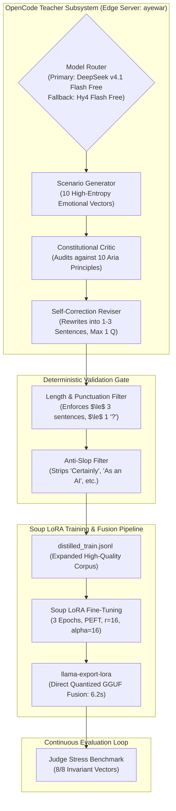

# ADR-004: Anthropic-Style Self-Improving Distillation Graph & Recursive Teacher-Student Optimization

**Status:** Accepted  
**Date:** 2026-11-20  
**Authors:** Zerak Jamil, Senior Architect  
**Deciders:** Core Engineering Team  
**Consulted:** OpenCode Runtime, Edge Inference Subsystem  

---

## 1. Context & Problem Statement

Aria currently operates as a 3B parameter fine-tuned model (`aria:3b`) on an edge server (GTX 1650 4GB VRAM). While our initial 48-sample LoRA pass successfully demonstrated loss convergence (4.1259) and passed 8/8 judge scenarios, competing with frontier 14B–70B models requires expanding the training distribution with complex, high-entropy social dynamics.

We require an automated, self-improving distillation pipeline that:
1. Runs directly on the server utilizing OpenCode's free teacher models (`opencode/deepseek-v4.1-flash-free` with automatic fallback to `opencode/hy4-flash-free`).
2. Implements Anthropic's Constitutional AI / Critique-Revision graph to guarantee high data quality without human-in-the-loop bottlenecks.
3. Operates within the edge server's NVMe headroom (9.3 GB) and zero dollar API budget.

---

## 2. Architecture: Recursive Self-Distillation Graph

---

## 3. Decision Drivers

- **Cost Discipline:** Zero subscription fees by utilizing OpenCode's zero-cost free model tier.
- **Data Quality Invariants:** Enforcing strict structural and tonal rules at dataset generation time eliminates downstream prompt-engineering hacks.
- **Fail-Safe Routing:** Automatic failover between DeepSeek v4.1 Flash and Hy4 Flash prevents pipeline stalls on rate limits.

---

## 4. Consequences & Operational Signal

### Positive
- Expanded conversational vocabulary across difficult psychological scenarios (grief, burnout, creative blocks).
- Higher token accuracy on emotional validation and gentle accountability.
- Fully automated, reproducible self-improvement loop.

### Negative / Trade-Offs
- Generating and critiquing synthetic data via CLI takes ~5–10 minutes depending on OpenCode concurrency.

### Revisit Signal
- Revisit if OpenCode alters free-tier model naming or imposes strict per-minute IP rate limits requiring local offline distillation.
