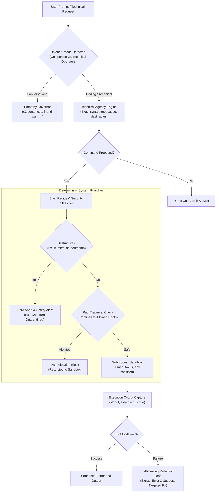

# ADR-005: Sandboxed Dual-Mode Terminal Agent & Safe System Execution Engine

**Status:** Accepted  
**Date:** 2026-11-20  
**Authors:** Zerak Jamil, Senior Architect & Lead Systems Engineer  
**Deciders:** Core Engineering Team  
**Consulted:** Edge Security & Linux System Administration Subsystem  

---

## 1. Context & Problem Statement

Aria was initially trained and configured as an empathetic conversational companion and gentle accountability partner. However, power users and developers require Aria to operate as a capable **technology and coding copilot** capable of:
1. Explaining complex code architectures, debugging stack traces, and writing idiomatic code (Python, Rust, C++, Bash).
2. Executing terminal commands on local machines, edge nodes, and workstations to inspect system vitals, manage containers, and run build/test pipelines.
3. Operating with zero tolerance for catastrophic failure ("not messing up could run a pc my bars are so high").

Allowing an LLM (especially a compact 3B model) to propose or execute terminal commands without rigorous harness constraints introduces critical risks:
- Hallucinated commands or flags causing system failure.
- Destructive commands (`rm -rf /`, formatting mounted NVMe volumes, kill-all scripts).
- Path traversal vulnerabilities modifying sensitive system configurations (`/etc/`, `/boot/`, `~/.ssh/`).
- Infinite hanging processes saturating edge CPU/RAM.

---

## 2. Architectural Design: The 4-Tier Safe Execution Engine

---

## 3. Command Classification & Blast Radius Matrix

| Category | Allowed Commands | Execution Policy |
| :--- | :--- | :--- |
| **Tier 0: Read-Only Vitals** | `ls`, `cat`, `head`, `tail`, `grep`, `find`, `git status`, `git diff`, `git log`, `ps`, `docker ps`, `systemctl status`, `df -h`, `free -m`, `uptime`, `which`, `curl -I` | **Auto-executable** with output truncation (max 100 lines). |
| **Tier 1: Safe Workspace Mutation** | `mkdir`, `touch`, `cp`, `mv`, `git add`, `git commit`, `pytest`, `python3 <test>`, `npm test`, `cargo check` | Executable within designated project workspace. |
| **Tier 2: Controlled System Mutation** | `systemctl restart <service>`, `docker restart`, `pip install`, `npm install` | Logged to `companion.db` with execution audit trail. |
| **Tier 3: Hard-Blocked Destructive** | `rm -rf /`, `mkfs`, `dd if=`, `:(){ :|:& };:`, `shutdown`, `reboot`, `systemctl stop ssh*`, `chmod -R 777 /`, `DROP DATABASE`, `mkswap` | **Permanently rejected**. Instant abort with security reason. |

---

## 4. Path Traversal & Sandbox Safeguards

1. **Path Normalization:** All file paths are resolved with `Path.resolve()` to eliminate symlink loops and `../` escapes.
2. **Environment Sanitization:** Environment variables passed to child subprocesses purge `AWS_SECRET_ACCESS_KEY`, `OPENAI_API_KEY`, `SSH_AUTH_SOCK`, and sensitive tokens.
3. **Strict Timeout:** Every execution has a default 20-second timeout to prevent deadlocks or unbuffered pipe exhaustion.
4. **Self-Healing Reflection:** When a command fails (`exit_code != 0`), the engine parses `stderr` (e.g. `ModuleNotFoundError: No module named 'x'`), provides the diagnostic explanation, and suggests the exact remediation command.

---

## 5. Decision Drivers & Validation Plan

- **Zero Hallucination Tolerance:** The model must never invent command output; if a command was executed, the true system stdout must be presented.
- **Auditability:** Every executed command is stored in `companion.db` under the `audit_logs` table.
- **Test Suite:** Automated unit tests covering all 4 tiers, timeout kills, path traversal attacks, and self-healing error extraction.
