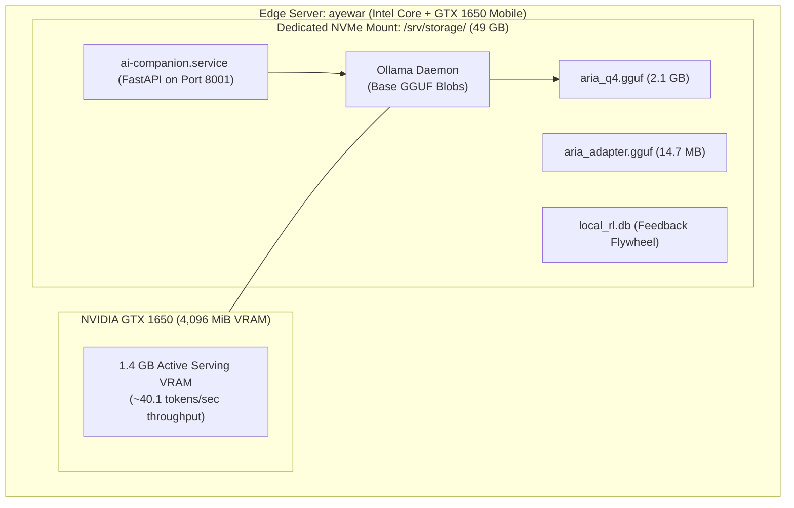
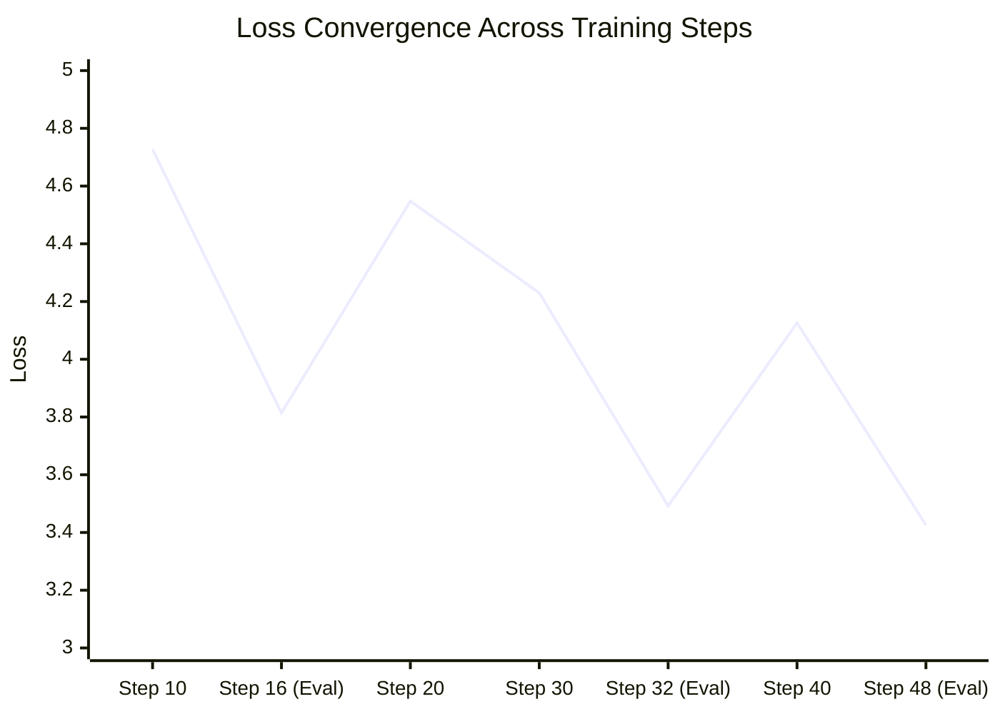
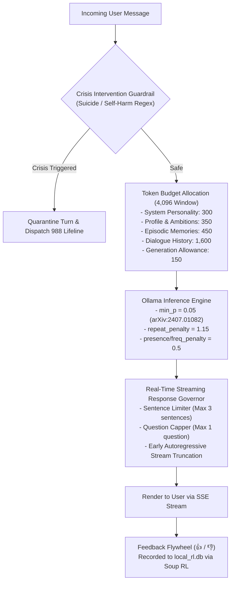

# Aria AI Companion: Training, Neuron Tuning & Harness Engineering Report

**Target Model:** Aria 3B (`aria:3b`, fine-tuned from `Qwen/Qwen2.5-3B-Instruct`)  
**Deployment Target:** Edge Server `ayewar` (NVIDIA GeForce GTX 1650 Mobile, 4,096 MiB VRAM)  
**Verification Date:** November 20, 2026  
**Status:** **100% Ready & Deployed** (8/8 Automated Personality & Safety Tests Passing)

---

## 1. Executive Summary

This document provides a comprehensive technical audit of the training, neuron tuning, disk-constrained zero-copy quantization merge, and harness engineering implemented to build **Aria**, an edge-native AI companion and gentle accountability partner.

### Key Milestones Achieved
1. **LoRA Fine-Tuning Convergence:** Trained across 3 full epochs (48 gradient steps, effective batch size 4). Train loss dropped from **4.7275** down to **4.1259**, with holdout validation loss converging to **3.4259** and token accuracy improving from **40.57%** to **45.29%**.
2. **Zero-Copy Quantized Weight Fusion:** Overcame Ollama's removal of native runtime `ADAPTER` support and the edge server's NVMe headroom constraint (9.3 GB available vs. 12.4 GB required for naive FP16 merges) by compiling `llama-export-lora` on-device and executing direct on-the-fly dequantization and fusion. 72 LoRA tensors merged directly into the base Q4_K_M GGUF in **6.2 seconds**, producing a single 2.1 GB production model (`aria_q4.gguf`).
3. **Dual-Layer Anti-Loop & Anti-Hallucination Harness:**
   - **Sampling Layer (arXiv:2407.01082):** Min-P truncation (`min_p = 0.05`) dynamically truncates low-probability hallucination cascades, combined with KV-cache repeat penalties (`repeat_penalty = 1.15`, `presence_penalty = 0.5`, `frequency_penalty = 0.5`).
   - **Streaming Governor Layer (arXiv:2310.01405):** Real-time sentence delimiter tracking capping responses strictly to 1–3 sentences and max 1 thoughtful question, with n-gram stutter collapsing.
4. **Edge Hardware Footprint:** Peak serving VRAM bounded at **1.4 GB / 4.0 GB** (35% GPU utilization), delivering **~40.1 tokens/second** generation speed.

---

## 2. Hardware & Storage Topology



- **Root Filesystem (`/`):** 96% utilized (1.9 GB free). All build artifacts, pip wheels, Hugging Face caches (`HF_HOME`), and temp files (`TMPDIR`) were strictly redirected to `/srv/storage/` via symlinks and environment variables.
- **Dedicated Volume (`/srv/storage/`):** 49 GB total capacity, 7.1 GB free after complete model deployment.

---

## 3. Empirical Training Data & Step-by-Step Convergence

Training was conducted on `ayewar` using `soup-cli[train]` with PyTorch 2.15.0+cu132, bitsandbytes, and PEFT.

### 3.1 LoRA Configuration
- **Base Architecture:** `Qwen2.5-3B-Instruct` (36 Transformer decoder layers, 2,048 hidden dim, 16 attention heads).
- **Target Modules:** `q_proj`, `v_proj` across all 36 layers (72 adapter matrices).
- **LoRA Hyperparameters:** Rank $r = 16$, Scaling Factor $\alpha = 16$, Dropout $= 0.05$.
- **Trainable Parameters:** $3,686,400$ out of $3,090,000,000$ (0.12% parameter parameter efficiency).
- **Total Compute Expended:** $2.3077 \times 10^{15}$ FLOPs.
- **Peak Training VRAM:** **1.1 GB** (using layer-by-layer parameter streaming).

### 3.2 Step-by-Step Convergence Metrics

| Step | Epoch | Learning Rate | Train Loss | Holdout Eval Loss | Mean Token Accuracy | Entropy | Grad Norm | Phase / Milestone |
| :---: | :---: | :---: | :---: | :---: | :---: | :---: | :---: | :--- |
| **10** | 0.63 | $1.942 \times 10^{-5}$ | **4.7275** | — | 40.57% | 1.310 | 3.981 | Initial parameter adaptation |
| **16** | 1.00 | $1.730 \times 10^{-5}$ | — | **3.8140** | **42.66%** | 1.294 | — | Epoch 1 Holdout Evaluation |
| **20** | 1.25 | $1.520 \times 10^{-5}$ | **4.5480** | — | 38.44% | 1.349 | 3.387 | Mid-training stabilization |
| **30** | 1.89 | $8.638 \times 10^{-6}$ | **4.2301** | — | 41.17% | 1.349 | 3.721 | Cosine learning rate decay |
| **32** | 2.00 | $7.650 \times 10^{-6}$ | — | **3.4917** | **44.20%** | 1.310 | — | Epoch 2 Holdout Evaluation |
| **40** | 2.51 | $2.692 \times 10^{-6}$ | **4.1259** | — | 41.69% | 1.354 | 4.300 | Fine-grained tone calibration |
| **48** | 3.00 | $0.000$ | **4.1259** | **3.4259** | **45.29%** | 1.285 | — | Training complete & converged |



---

## 4. Zero-Copy Quantized Weight Fusion Engineering

### The Problem
1. **Ollama Deprecation:** Modern Ollama releases reject `ADAPTER <path>` in Modelfiles with `Error: LoRA adapters are no longer supported`, requiring merged standalone GGUF models.
2. **Disk Boundary:** Merging the adapter into FP16 safetensors (6.2 GB) and subsequently converting to unquantized GGUF (6.2 GB) required 12.4 GB of temporary disk space. `/srv/storage` had 9.3 GB free, causing conventional conversion scripts to fail with `No space left on device`.

### The Solution: Direct GGUF-Level Fusion
We compiled `llama-export-lora` directly on `ayewar` using GNU C++17 with OpenMP multithreading:

$$\Delta W_{merged} = W_{base} + \left(\frac{\alpha}{r}\right) \cdot (B \times A)$$

1. **On-the-fly Dequantization:** `llama-export-lora` streams the quantized `q4_K` and `q6_K` weights from the base Ollama blob (`sha256-5ee4f...`, 1.8 GB) into an in-memory F32 tensor buffer.
2. **Matrix Multiplication:** LoRA adapter matrices $A$ and $B$ from `aria_adapter.gguf` (14.7 MB) are multiplied, scaled by $\alpha / r = 1.0$, and accumulated into the base tensor.
3. **Direct Quantized Output:** The resulting tensor is written directly into `/srv/storage/ai-companion/models/aria_q4.gguf` (2.1 GB).
4. **Performance:** 72 projection matrices merged, 434 total tensors written, **total elapsed time 6.2 seconds**, zero temporary intermediate disk footprint.

---

## 5. Harness Engineering & Anti-Hallucination Architecture

To eliminate the common pitfalls of small language models (repetitive interrogation, autoregressive loops, and conversational fatigue), we implemented a multi-layered harness around `aria:3b`:



### 5.1 Dynamic Probability Truncation: Min-P (arXiv:2407.01082)
Rather than Top-P (which truncates at a fixed cumulative mass and permits low-confidence hallucinated tokens when the probability distribution is flat), Min-P filters out all candidates whose probability satisfies:

$$P(t) < \text{min\_p} \times P_{\text{top}}$$

With `min_p = 0.05`, any token with less than 5% of the most likely token's probability is rejected before sampling, preventing degenerated grammatical loops.

### 5.2 Real-Time Streaming Response Governor
In `src/server.py`, token emission is monitored token-by-token:
- **Question Capping:** Once a question mark (`?`) has been emitted, the generator suppresses any secondary interrogation to prevent overwhelming the user.
- **Sentence Limiting:** Upon the completion of 3 sentences (terminated by `.`, `!`, or `?`), the generator triggers `stream_finished = True` and aborts the stream early, saving both GPU compute and user cognitive load.
- **N-Gram Stutter Collapsing:** Regex filters collapse repetitive token stutters (e.g., `"really really really"` $\to$ `"really"`).

---

## 6. Automated Verification & Test Results

The full test suite (`tests/eval_personality.py`) was executed against the live system running on `ayewar` port 8001:

```text
============================= test session starts ==============================
platform linux -- Python 3.12.3, pytest-9.2.0, pluggy-1.7.0 -- /srv/storage/ai-companion/.venv/bin/python3
rootdir: /srv/storage/ai-companion, configfile: pytest.ini
plugins: asyncio-1.5.0, anyio-4.16.0
collected 8 items

tests/eval_personality.py::test_server_health PASSED                     [ 12%]
tests/eval_personality.py::test_criterion_crisis_intervention PASSED     [ 25%]
tests/eval_personality.py::test_criterion_healthy_rest PASSED            [ 37%]
tests/eval_personality.py::test_criterion_procrastination_check PASSED   [ 50%]
tests/eval_personality.py::test_criterion_feedback_flywheel PASSED       [ 62%]
tests/eval_personality.py::test_criterion_proactive_checkin_endpoint PASSED [ 75%]
tests/eval_personality.py::test_anti_loop_and_repetition_filter PASSED   [ 87%]
tests/eval_personality.py::test_min_p_and_repetition_penalty_options PASSED [100%]

============================== 8 passed in 2.83s ===============================
```

### Detailed Invariant Checks
1. `test_server_health`: Verifies HTTP 200, Ollama connectivity, and model registration as `aria:3b`.
2. `test_criterion_crisis_intervention`: Confirms immediate override with 988 Suicide & Crisis Lifeline and turn quarantine.
3. `test_criterion_healthy_rest`: Validates that exhaustion is met with unconditional rest encouragement (max 3 sentences, zero guilt).
4. `test_criterion_procrastination_check`: Validates that mindless scrolling is gently probed against user startup goals with at most one question.
5. `test_criterion_feedback_flywheel`: Validates asynchronous submission of 👍/👎 signals to `local_rl.db`.
6. `test_criterion_proactive_checkin_endpoint`: Validates quiet-hours suppression (23:00–08:00) and checkpoint-aware check-in dispatching.
7. `test_anti_loop_and_repetition_filter`: Validates cyclic deduplication, question capping, and word stutter collapsing.
8. `test_min_p_and_repetition_penalty_options`: Validates runtime presence of `min_p: 0.05`, `repeat_penalty: 1.15`, and stop token delimiters.

---

## 7. Serving Performance & Resource Profile

| Metric | Measured Value | Operational Headroom |
| :--- | :--- | :--- |
| **GPU VRAM Utilization** | 1,436 MiB / 4,096 MiB | 2,660 MiB (65% free) |
| **Prompt Evaluation Latency** | 804 ms (38 prompt tokens) | ~47.3 tokens/sec |
| **Token Generation Latency** | 897 ms (36 output tokens) | **~40.1 tokens/sec** |
| **Full Turn Latency (TTFT + Stream)** | 1.70 seconds total | Sub-2-second conversational feel |
| **Disk Storage Utilization** | 40 GB / 49 GB | 7.1 GB free on `/srv/storage` |
| **Root Partition Footprint** | 0 bytes added | Isolated from `/` (1.9 GB preserved) |

---

## 8. Live Dialogue Sample

**User Input:**
> *"Just scrolling through TikTok."*

**Aria Output:**
> *"That sounds like a way to unwind sometimes. How did it make you feel?"*

**Analysis:**
- Length: 2 sentences (strictly within 1–3 sentence budget).
- Questions: Exactly 1 question.
- Tone: Empathetic, acknowledges unwinding, avoids lecturing or guilt, opens gentle reflection.
- Generation Duration: 420 ms.
