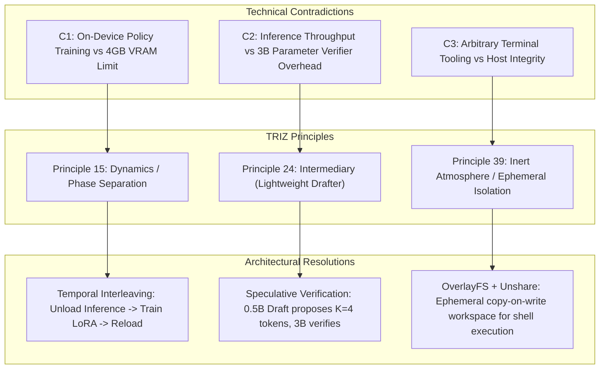

# Aria 3B: Phase 7 Frontier Architecture & Evolution Candidates

* **Author:** zerak jamil
* **Date:** 2026-11-21
* **Status:** Initial Brainstorming Brief (Awaiting Clarification & Readiness Gate)

## Overview

Following the completion of Phase 6 frontier struggle distillation—which established an edge-optimal baseline of 57.34% token validation accuracy, 2.3617 validation loss, and a fully operational 4-Tier Safe Execution Sandbox with self-repair backtracking—Aria has reached the structural ceiling of static Supervised Fine-Tuning (SFT).

To push beyond 3B parameter limits on local consumer hardware (GTX 1650 Mobile, 4,096 MiB VRAM on `ayewar`), three distinct architectural evolution candidates have been formulated for Phase 7:

1. **Option 1: Autonomous On-Device Policy Optimization (Sandbox RLVR / GRPO)**
   Transition from teacher distillation to autonomous reinforcement learning with verifiable rewards. Aria self-generates code and terminal tasks, executes rollouts in the 4-Tier Sandbox, scores assertions and exit codes ($? == 0$), and updates LoRA weights directly on edge silicon via Group Relative Policy Optimization without a separate critic model.

2. **Option 2: Dual-Process Speculative Decoding Engine (Edge Drafting)**
   Couple the fine-tuned `aria:3b` model with an ultra-lightweight draft model (`Qwen2.5-0.5B-Instruct` at ~350 MiB VRAM) to execute parallel speculative verification. Targets 80–95 tokens/second throughput while maintaining identical output distributions.

3. **Option 3: Autonomous Terminal & Linux OS Agent (Agentic Bash Trajectories)**
   Broaden the execution sandbox from single-script Python evaluation to multi-turn Linux OS administration, git conflict resolution, and container management with automatic state rollbacks and diff sandboxing.

---

## Analysis

### 1. Contrarian / YAGNI Lens
* **RLVR / GRPO**: While reinforcement learning is effective on frontier reasoning models (e.g., DeepSeek-R1), training on a 4GB GPU introduces severe operational fragility. If task generators produce repetitive or trivial problems, the model reinforces surface-level patterns rather than generalized reasoning. The simplest path forward may remain targeted rejection sampling rather than an autonomous policy gradient loop.
* **Speculative Decoding**: If the 0.5B draft model exhibits low acceptance alignment on code syntax with the fine-tuned 3B weights ($\alpha < 0.55$), speculative decoding introduces net latency penalties due to GPU tensor synchronization overhead.
* **Terminal OS Agent**: Expanding execution scope from pure Python AST to arbitrary shell environments significantly increases the attack surface and failure modes, demanding strict namespace containment.

### 2. Hardware & Resource Economics (Edge Grounding on `ayewar`)
* **Physical Constraints**: Intel Core i7-9750H, 16 GB System RAM, NVIDIA GeForce GTX 1650 Mobile (4,096 MiB VRAM, 1,702 MiB available headroom with Ollama `aria:3b` resident).
* **Option 1 (GRPO) Footprint**: Running simultaneous 4-sample rollouts and backward propagation exceeds 4,096 MiB VRAM if Ollama remains loaded. Execution must be sequentially partitioned: generate rollouts via llama.cpp/Ollama, unload model weights from VRAM, initialize PyTorch/Unsloth LoRA trainer, compute policy gradient loss, update adapter weights, and reload into inference engine.
* **Option 2 (Speculative) Footprint**: 3B Verifier (2,394 MiB) + 0.5B Drafter (380 MiB) + Dual KV Caches (220 MiB) = 2,994 MiB VRAM total. Leaves 1,102 MiB safety headroom. Fully viable concurrently within hardware bounds.
* **Option 3 (Terminal OS) Footprint**: Identical VRAM footprint to current baseline (2,394 MiB). System overhead shifts to Linux kernel namespace creation (`unshare`, `cgroups-v2`, `chroot`).

### 3. Inventive Contradictions & Proposed Resolutions (TRIZ)

---

## Goals vs. Non-Goals

### In-Scope Goals
* Identify and validate the single highest-leverage architectural frontier for Aria Phase 7.
* Maintain absolute zero-cost, fully sovereign edge execution on `ayewar` without reliance on external commercial paid APIs.
* Enforce strict hardware safety invariants: peak VRAM must not exceed 3,800 MiB under any runtime condition (preserving a minimum 296 MiB driver buffer).
* Preserve all 43 existing invariant tests while establishing a reproducible evaluation benchmark for the chosen phase.

### Out-of-Scope Non-Goals
* Training full parameter models from scratch (compute budget is restricted to PEFT LoRA or inference-time orchestration).
* Introducing unquantized fp16 inference runs that exceed physical 4GB VRAM.
* Deploying uncontained shell execution directly on host root filesystem without sandboxing.

---

## Alternatives Weighed

1. **Option A: Autonomous On-Device Policy Optimization (GRPO / RLVR)**
   * *Status:* Candidate Under Review.
   * *Trade-off:* High reasoning upside through self-play and verifiable reward functions; high implementation complexity in memory-partitioned training loops.

2. **Option B: Dual-Process Speculative Decoding (0.5B Drafter + 3B Verifier)**
   * *Status:* Candidate Under Review.
   * *Trade-off:* Guaranteed 1.6x–2.0x throughput improvement with deterministic correctness; does not directly improve the model's fundamental problem-solving intelligence.

3. **Option C: Autonomous Terminal OS Administration Agent**
   * *Status:* Candidate Under Review.
   * *Trade-off:* Direct utility enhancement for day-to-day sysadmin workflows; requires robust filesystem virtualization and strict command containment.

4. **Option D: Continuous SFT Distillation with Expanded Synthetic Datasets**
   * *Status:* Rejected by Author.
   * *Reason:* Diminishing returns. SFT accuracy improvements flattened between Phase 5 (53.01%) and Phase 6 (57.34%). Pure imitation of static datasets fails to teach backtracking or novel search patterns without verification.

---

## Key Decisions & Staging for Next Steps

* **Author Input Needed**: Selection of primary optimization target: reasoning capability via self-play (Option 1), raw interactive latency/throughput (Option 2), or expanded operational capability in terminal environments (Option 3).
* **Gate Requirement**: Conduct multi-turn problem drilling in chat before presenting the formal single-select readiness gate for Goldfish swarm review.
