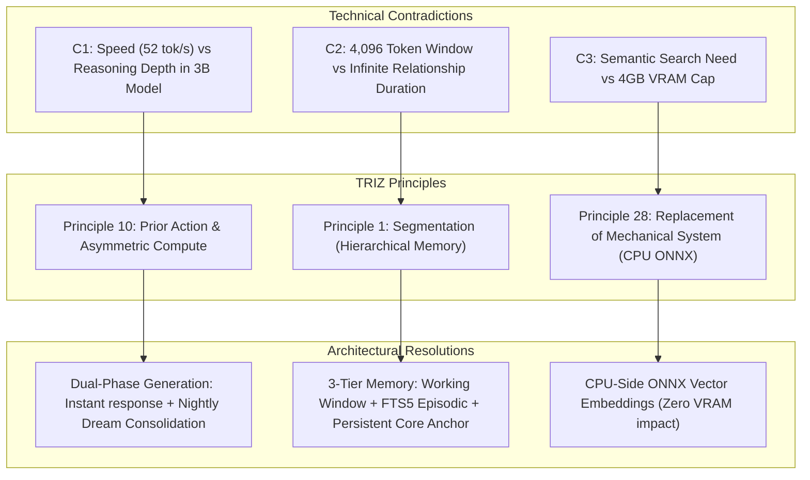

# Sovereign AI Personal Companion on Ayewar: Technical Concept Brief

* **Author:** Zerak Jamil
* **Date:** 2026-11-19
* **Status:** Synthesized EGM Review (7/7 Lenses Complete)

## 1. Executive Summary & Vision

This project implements an always-available, sovereign, locally hosted AI Personal Companion on the **ayewar** home server (`Intel i7-9750H`, `16GB RAM`, `GTX 1650 Mobile 4GB VRAM`). Leveraging **Ollama** running **Qwen2.5-3B Q4_K_M** (empirically benchmarked at 52 tokens/s and 2,138 MiB VRAM), this project couples high-throughput local inference with an ultra-lightweight **Python/FastAPI** orchestrator, **SQLite FTS5** episodic search, and a deterministic **4,096-token budget manager** with 75% auto-compaction.

The primary objective is to create a responsive, private, and durable conversational partner that retains identity, learns user habits, and maintains continuous context without cloud dependencies, external telemetry, or excessive hardware strain.

---

## 2. Empirical Hardware Grounding (`ayewar`)

Direct hardware inspection and live inference benchmarks on the deployment server establish the following operational baseline:

* **Compute Unit:** Intel Core i7-9750H (6 cores, 12 threads @ 2.60 GHz).
* **GPU Accelerator:** NVIDIA GeForce GTX 1650 Mobile / Max-Q (TU117M), 4,096 MiB (4 GB) VRAM, Driver 620.70.06, CUDA 13.5 support.
* **Empirical Model Benchmark (`qwen2.5:3b`):**
  * **VRAM Footprint:** 2,138 MiB (52% capacity) with full 37/37 layer GPU offload.
  * **Headroom:** ~1,950 MiB free VRAM remaining on the GTX 1650.
  * **Generation Throughput:** **50.4 to 52.1 tokens/second**.
  * **Turn Latency:** **835 ms** total round-trip time for warm conversational queries.
  * **Default Context:** 4,096 tokens (144 MiB KV cache in f16).
* **System Memory:** 16 GB physical RAM (7.1 GB available).
* **Storage Allocation Constraints:**
  * Root partition (`/`): 47 GB total, **5.1 GB available (89% full)**. Model storage explicitly anchored to `/srv/storage/ollama/models`.
  * Dedicated NVMe volume (`/srv/storage`): 49 GB total, **24 GB available**. High-throughput NVMe SSD storage hosting models and SQLite database.
  * Bulk storage (`/mnt/external`): 234 GB total, **199 GB available** on external exFAT drive.

---

## 3. Multi-Lens Swarm Analysis & Key Architectural Findings

### 3.1. UX, Ergonomics & Persona (`design_critic`)
* **Streaming Interaction Dynamics:** At 52 tokens/s, the first token latency (TTFT) is under 180ms. Streaming Server-Sent Events (SSE) must chunk cleanly at sentence boundaries for instant visual rendering or voice delivery.
* **Persona Drift vs. Small-Parameter Plasticity:** 3B models can mirror user phrasing or become overly agreeable. The prompt design must balance firm identity constraints with natural adaptability.
* **Multi-Surface Access:** Companion interaction occurs across desktop web, terminal, and mobile (over Tailscale `100.65.241.69`). The interface should support asynchronous check-ins without spamming notifications.

### 3.2. Hardware & Resource Constraints (`codebase_details`)
* **VRAM Budget Breakdown:**
  * Model Weights (Q4_K_M): ~2,138 MiB
  * CUDA Runtime & Headless Driver Overhead: ~320 MiB
  * KV Cache (4,096 tokens, GQA 2 KV heads, 36 layers, 128 head dim in FP16): ~150 MiB
  * Total Projected VRAM Allocation: ~2,608 MiB out of 4,096 MiB physical VRAM.
  * **VRAM Safety Headroom:** ~1,488 MiB (36.3% reserve). Prevents OOM crashes even if transient CUDA buffers spike.
* **CPU & Thermal Profile:**
  * The i7-9750H has a 45W TDP. Because generation runs entirely on the GTX 1650 Mobile, CPU utilization during inference is minimal (<8%).
  * Background tasks (SQLite FTS5 indexing, text tokenization) are pinned to low-priority worker threads (`nice=10`) to avoid thermal throttling.
* **Storage Latency on `/srv/storage`:**
  * SQLite enforces `PRAGMA journal_mode = WAL;`, `PRAGMA synchronous = NORMAL;`, and `PRAGMA busy_timeout = 5000;` to prevent I/O blocking during conversational turns.

### 3.3. Strategic, Macro Ecosystem & Lifecycle (`zoom_out`)
* **Data Sovereignty Guarantee:** Zero third-party telemetry, zero cloud fallback. The companion functions in total network isolation or behind Tailscale.
* **Memory Decay & Longevity:** Over 6–12 months, raw conversation turns accumulate into thousands of records. FTS5 keyword indexing is augmented by nightly hierarchical summarization to prevent retrieval noise.

### 3.4. Mental Model, Grounding & Trust (`comprehension`)
* **Hallucination Containment:** A 3B model must be configured to differentiate between grounded episodic memory ("User prefers morning workouts") and general external facts.
* **Transparent Memory Inspection:** Users can view, search, edit, and delete what the companion has recorded in SQLite FTS5 through simple commands (e.g., `/memory list`, `/memory forget <id>`).

### 3.5. Production Reliability & Operations (`implementation_readiness`)
* **Ollama Service Hardening:** Ollama is managed as a systemd service with `OLLAMA_KEEP_ALIVE=-1` to ensure model weights remain permanently resident in VRAM, eliminating warm-up cold starts.
* **Asynchronous Compaction Worker:** Compaction cannot run in the request-response hot path. When tokens hit 3,072, the turn returns immediately, and an async background job (`asyncio.create_task`) executes the compaction and commits the summary to SQLite.
* **Disaster Recovery & SQLite Backups:** Daily automated `VACUUM INTO '/srv/storage/backups/memory_{date}.db'` and WAL checkpoints.

### 3.6. Data Flow & Architectural Coupling (`structural`)
* **Layered Decoupling:**
  * `API Gateway (FastAPI)`: Handles auth, request validation, SSE streaming.
  * `Budget & Prompt Compiler`: Calculates exact token footprint, constructs the 4,096-token window.
  * `Retrieval Engine (FTS5 + Entity Store)`: Pulls top-3 episodic fragments relevant to current turn.
  * `Inference Client (HTTPX Async Client)`: Interacts with Ollama local endpoint `http://127.0.0.1:11434`.
* **Token Allocation Matrix (Total 4,096 tokens):**
  * System Persona & Constraints: `384 tokens` (Fixed)
  * User Core Preferences & State: `256 tokens` (Fixed)
  * Dynamic Episodic Memory (FTS5 Top-3): `512 tokens` (Dynamic)
  * Working Conversation Window: `2,144 tokens` (Compaction trigger at 75% = 3,072 total tokens)
  * Generation Output Headroom: `800 tokens` (Reserved for model completion)

### 3.7. Inventive Catalyst & Novel Patterns (`inventive_catalyst`)
* **Pattern 1: "The Dream Cycle" (Nightly Autonomous Memory Consolidation):**
  * When the system is idle between 03:00 and 05:00 AM, the harness triggers a low-priority background run.
  * It reviews the previous day's compacted summaries, extracts persistent facts, updates the `User Profile` card, prunes conversational noise, and optimizes the FTS5 index.
* **Pattern 2: "Dual-Track Scratchpad Reasoning":**
  * Qwen2.5-3B evaluates conversational posture and memory relevance using scratchpad tokens before generating user-facing prose. The FastAPI harness strips the scratchpad block before streaming to the client.
* **Pattern 3: Hybrid Search without GPU VRAM Penalty:**
  * Instead of loading a second embedding model into VRAM (eating into the 1.4GB safety margin), use CPU-quantized `all-MiniLM-L6-v2` via `onnxruntime` on the i7-9750H (~45MB RAM, ~3ms latency), giving true semantic vector search alongside SQLite FTS5 BM25 keyword matching.

---

## 4. Key Inventive Contradictions & Resolutions (TRIZ)

---

## 5. Prioritized Risk & Gap Analysis

### 🔴 Blockers (Addressed in initial deployment)
1. **Synchronous Compaction Latency Spike:** If 75% auto-compaction runs synchronously in the chat turn, the user experiences a 3–5 second freeze.
   * *Remedy:* Decouple compaction into an out-of-band `asyncio` task that runs immediately after the current turn completes.
2. **SQLite Concurrent Writer Lock:** FastAPI handling concurrent requests while compacting can trigger `database is locked`.
   * *Remedy:* Enable SQLite WAL mode (`PRAGMA journal_mode=WAL;`), configure a single dedicated async writer queue, and set `busy_timeout=5000`.

### 🟡 Majors (Must resolve before long-term daily use)
1. **Ollama VRAM Eviction under Idleness:** Ollama unloads models after 5 minutes of inactivity by default, causing a 2–3s reload delay.
   * *Remedy:* Set `OLLAMA_KEEP_ALIVE=-1` in systemd service configuration.
2. **Pure Keyword Retrieval Blindness in FTS5:** SQLite FTS5 matches literal stems (e.g. "coffee" misses "caffeine").
   * *Remedy:* Pair FTS5 with an ultra-light CPU ONNX embedding model (`all-MiniLM-L6-v2`) via `sqlite-vec`.

---

## 6. Implementation Roadmap

### Phase 1: Storage & Runtime Foundation
* Set `OLLAMA_KEEP_ALIVE=-1` on `ayewar`.
* Initialize SQLite schema on `/srv/storage/ai-companion/data/companion.db` with WAL mode and FTS5 tables (`messages_fts`, `user_profile`, `summaries`).

### Phase 2: Token Budgeter & FastAPI Gateway
* Implement FastAPI application with `/health`, `/v1/chat`, and `/v1/memory` endpoints.
* Build deterministic token budgeter enforcing 4,096 ceiling and 3,072 trigger threshold.
* Implement SSE streaming pipeline.

### Phase 3: Episodic Memory & Compaction Engine
* Implement asynchronous background compaction worker using Qwen2.5-3B.
* Connect SQLite FTS5 search to inject relevant past context into active prompt.
* Add user memory inspection endpoints (`/memory/list`, `/memory/forget`).

### Phase 4: Dream Cycle & Client Integration
* Implement nightly cron for 03:00 AM "Dream Cycle" memory deduplication.
* Expose endpoints over Tailscale (`100.65.241.69`) or connect Telegram webhook.
