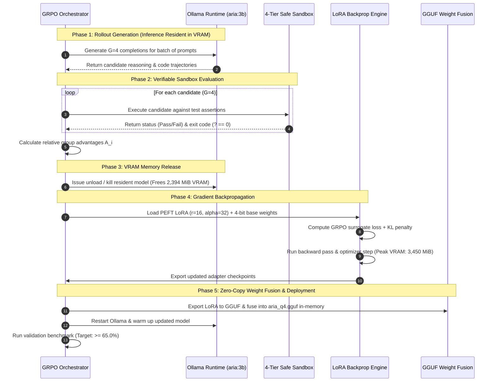

# Aria Phase 7: Autonomous On-Device Policy Optimization (GRPO/RLVR) & Sandboxed Linux System Administration

*   **Author:** zerak jamil
*   **Status:** Proposed
*   **Date:** 2026-11-21

--------------------------------------------------------------------------------

## Overview

This document specifies the technical design for Aria Phase 7 on the edge server `ayewar` (`Intel i7-9750H`, `16GB RAM`, `GTX 1650 Mobile 4GB VRAM`). Building upon Phase 6's frontier struggle distillation—which established an edge baseline of 57.34% validation token accuracy, 2.3617 validation loss, and a 4-Tier Safe Sandbox self-repair loop—Phase 7 transitions Aria from static Supervised Fine-Tuning (SFT) imitation to autonomous on-device policy optimization using verifiable rewards, while expanding the model's domain into sandboxed Linux server maintenance.

The design couples two tightly integrated objectives:
1. **Autonomous Policy Optimization (GRPO/RLVR):** Aria generates candidate reasoning trajectories and code solutions across algorithmic and system-maintenance tasks, executes them inside the local 4-Tier Sandbox, verifies outcomes against objective unit test assertions ($? == 0$), and optimizes LoRA adapter weights directly on the GTX 1650 Mobile using Group Relative Policy Optimization (GRPO).
2. **Sandboxed Linux System Administration:** Aria is trained to inspect host system telemetry in a read-only posture (parsing service states, process tables, network sockets, and disk usage) while strictly restricting all diagnostic execution, scripts, and repair actions to isolated sandbox namespaces.

The primary target for Phase 7 is raising evaluation token accuracy from the current 57.34% baseline to **65.0%**, establishing the foundation for subsequent 68%, 70%, and 80% milestones.

--------------------------------------------------------------------------------

## The Problem

1. **The Structural Ceiling of Supervised Imitation (SFT):** SFT trains the 3B model to mimic teacher tokens without exploring alternative reasoning branches. Once high-entropy failure vectors are covered, training loss plateauing and generalization gaps emerge (progress slowed from Phase 5's 53.01% to Phase 6's 57.34%). To reach 65%+ accuracy, the model must learn through trial, error, and reinforcement against objective execution ground truth.
2. **Hardware Constraints on Reinforcement Learning (4GB VRAM):** Standard Actor-Critic RL algorithms (such as PPO) require maintaining the actor policy, reference policy, value/critic model, and reward model simultaneously in GPU memory. On a 4,096 MiB GPU, loading multiple 3B models causes immediate Out-Of-Memory (OOM) failures.
3. **Host Mutation Hazards in System Administration:** Enabling an AI companion to diagnose and maintain servers introduces significant operational hazards. Unrestricted shell execution can lead to destructive host modifications (e.g., recursive deletion, corrupted service configurations, broken network rules). Safe system administration training requires a strict separation: host telemetry must be strictly read-only, and any candidate command execution or file repair must be confined within an isolated sandbox.

--------------------------------------------------------------------------------

## Goals

*   **G1 (Empirical Accuracy Target):** Advance evaluation token accuracy on held-out frontier struggle sets from **57.34% to $\ge 65.0\%$**, with validation loss decreasing below **2.1500**.
*   **G2 (Zero-Critic On-Device Policy Optimization):** Implement Group Relative Policy Optimization (GRPO) on edge silicon, sampling groups of $G=4$ completions per prompt, calculating normalized advantage scores from binary sandbox execution rewards ($\pm 1.0$), and updating LoRA adapter weights without allocating a separate critic model.
*   **G3 (Temporal Memory Interleaving on 4GB VRAM):** Enforce strict phase interleaving between rollout generation and gradient backpropagation. The edge pipeline unloads inference weights from VRAM before initializing the LoRA backward pass, maintaining peak VRAM under 3,800 MiB (preserving $\ge 296 \text{ MiB}$ safety headroom).
*   **G4 (Read-Only Host Telemetry Inspection):** Equip Aria with structured tools to query Linux system state (`systemctl status`, `journalctl -n`, `df -h`, `ss -tulpn`, `uptime`, `free -m`) with read-only guarantees.
*   **G5 (Strictly Sandboxed Mutation & Execution):** Direct all shell commands, script execution, and file alterations into isolated ephemeral sandbox environments (Bubblewrap / Linux namespaces / AST-bounded sandbox). Direct uncontained command execution on the host filesystem is strictly prohibited.
*   **G6 (Invariant Preservation):** Retain 100% green status across all 43 existing test invariants in `tests/test_invariants.py`.

--------------------------------------------------------------------------------

## Non-Goals

*   **NG1 (Direct Host Shell Mutation):** Aria will not execute uncontained root or write commands (`systemctl restart`, `rm`, `apt install`, editing `/etc/`) on the live host environment. All state-altering remediation must be demonstrated and verified within the sandbox.
*   **NG2 (Full Parameter Training):** No full-parameter backpropagation ($3\times 10^9$ parameters in fp16 require 24GB+ VRAM). All training is strictly bounded to Parameter-Efficient Fine-Tuning (PEFT LoRA rank $r=16$, $\alpha=32$).
*   **NG3 (Cloud-Dependent Reward Models):** No reliance on external commercial APIs for reward scoring during training. Rewards are strictly derived from local sandbox exit codes ($? == 0$) and assertion evaluations.
*   **NG4 (Continuous Live Chat Availability During Training):** Because server `ayewar` is dedicated to Aria optimization for this 12-hour window, live conversational chat will not be kept concurrently resident in VRAM during active gradient backpropagation cycles.

--------------------------------------------------------------------------------

## Open Questions

*   **OQ1 (Rollout Engine Selection):** Whether to generate the $G=4$ policy rollouts via `llama.cpp` CLI (direct GGUF execution with minimal startup latency) or via Ollama REST API before issuing the unload command.
*   **OQ2 (KL Penalty Scheduling):** How aggressively to scale the Kullback-Leibler (KL) divergence penalty ($\beta \in [0.01, 0.05]$) between the active policy and frozen reference policy to prevent policy collapse on edge-generated code.
*   **OQ3 (Synthetic Problem Diversity vs. Repetition):** Whether self-generated coding problems will produce sufficient syntactic entropy without external seed problem banks.

--------------------------------------------------------------------------------

## Critical User Journeys (CUJs)

### CUJ 1: Autonomous Policy Optimization Step (Generate, Execute, Reinforce)

*   **Given**: A batch of 8 algorithmic and system diagnostic challenges with verifiable assertion blocks. Aria's LoRA adapter is loaded at iteration $t$.
*   **When**: The GRPO pipeline initiates a training cycle:
    1. For each challenge, the model samples $G=4$ completion trajectories with temperature $T=0.7$.
    2. Each completion is dispatched to the 4-Tier Safe Sandbox.
    3. The sandbox executes candidates against hidden assertions: passing completions receive reward $R = +1.0$, while syntax errors, timeouts, or assertion failures receive $R = -1.0$.
    4. Advantage is normalized across the 4 completions ($A_i = \frac{R_i - \text{mean}(R)}{\text{std}(R)}$).
*   **Then**:
    1. Inference memory is cleared.
    2. PyTorch evaluates the policy gradient loss clipped by $\epsilon = 0.2$ with KL penalty against the reference model.
    3. The optimizer updates LoRA weights on the GTX 1650 Mobile within the 3,800 MiB VRAM envelope.
    4. The updated adapter is saved and verified against the validation set.

### CUJ 2: Diagnostic System Triage in Read-Only Mode

*   **Given**: A service failure occurs on the server (e.g., simulated high memory pressure or a dead mock daemon).
*   **When**: The user prompts Aria: *"The background worker service is failing. Find out why."*
*   **Then**:
    1. Aria invokes read-only host inspection tools: queries `systemctl status mock-worker.service` and retrieves recent log lines via `journalctl -u mock-worker -n 20 --no-pager`.
    2. Aria identifies the root cause (e.g., missing environment variable or permission error on socket).
    3. Aria constructs a reproduction script and a proposed fix inside an isolated sandbox environment.
    4. Aria tests the fix inside the sandbox, verifies that exit code is 0, and presents the exact diagnosis and remediation diff to the user without touching the host configuration.

### CUJ 3: Self-Repair Verification on Injected Edge Case

*   **Given**: An edge case involving off-by-one list indexing and unhandled `None` returns in a Python diagnostic parser.
*   **When**: Aria's first candidate solution raises `IndexError: list index out of range` in the sandbox.
*   **Then**:
    1. The 4-Tier Sandbox intercepts the exception, extracts the minimal traceback (failing line and input values), and formats a `<reflection>` memory block.
    2. Aria ingests the reflection, adjusts its reasoning scratchpad, and emits candidate 2 with a bounds check.
    3. Candidate 2 passes all assertions ($? == 0$).
    4. The successful reasoning trace is selected for positive reinforcement.

--------------------------------------------------------------------------------

## Technical Plan (Architecture)

The Phase 7 architecture introduces a decoupled, three-subsystem topology on `ayewar`: the **Read-Only Telemetry Inspector**, the **Sandboxed Diagnostic & Repair Engine**, and the **On-Device GRPO Self-Evolution Pipeline**.

```
+-------------------------------------------------------------------------------------------------+
|                                    Aria Agent Runtime Core                                      |
+-------------------------------------------------------------------------------------------------+
           |                                             |                                 |
           | 1. Read-Only Telemetry                      | 2. Candidate Diagnosis          | 3. Policy Update
           v                                             v                                 v
+-----------------------+                    +-----------------------+         +-----------------------+
|  Host System Probe    |                    |  4-Tier Safe Sandbox  |         |  GRPO Training Loop   |
|  (Read-Only Interface)|                    |  (Ephemeral Env)      |         |  (Phase-Interleaved)  |
|                       |                    |                       |         |                       |
| * systemctl status    |                    | * Bubblewrap / bwrap  |         | * Rollout Gen (G=4)   |
| * journalctl -u ...   |                    | * Network unshare (-n)|         | * Sandbox Eval (+/-1) |
| * df -h / ss -tulpn   |                    | * Tempfs /tmp mount   |         | * Advantage Norm      |
| * Strict regex filter |                    | * rlimit CPU / Memory |         | * VRAM Unload Step    |
| * No shell expansion  |                    | * Traceback parser    |         | * LoRA Backprop       |
+-----------------------+                    +-----------------------+         +-----------------------+
           |                                             |                                 |
           v (Host Read-Only)                            v (Isolated Execution)            v (Zero-Copy Fusion)
+-------------------------------------------------------------------------------------------------+
|                                Edge Hardware Substrate (ayewar)                                 |
|  * NVIDIA GTX 1650 Mobile (4,096 MiB VRAM)                                                      |
|  * High-Throughput NVMe Storage (/srv/storage)                                                  |
|  * Model Weights: aria_q4.gguf (2.17 GB) + Qwen2.5-3B LoRA Adapter                              |
+-------------------------------------------------------------------------------------------------+
```

### 1. Architectural Subsystems

#### 1.1. Read-Only Telemetry Probe (`src/telemetry_probe.py`)
To enable server maintenance capabilities without introducing host mutation risks, all host queries are mediated through a hard-sandboxed interface:
* **Whitelist-Only Command Registry:** Commands are restricted to a closed enumerated set:
  - `systemctl status <service>`
  - `journalctl -u <service> -n <lines> --no-pager`
  - `df -h <path>`
  - `ss -tulpn`
  - `free -m`
  - `uptime`
  - `ps aux --sort=-%mem | head -n 15`
* **Direct Process Invocation:** Commands execute via `subprocess.run(args_list, shell=False, capture_output=True, timeout=5.0)`. Passing raw strings to `/bin/sh` or `/bin/bash` is strictly disallowed, preventing command chaining (`&&`, `;`, `|`) or command substitution (`$()`, `` ` ``).
* **Sanitization Filter:** Input arguments (e.g., service names, paths) are checked against strict alphanumeric regexes (`^[a-zA-Z0-9_\-\.]+$`).

#### 1.2. Sandboxed Diagnostic & Repair Engine (`src/sandbox_runner.py` & `src/self_repair.py`)
When diagnosing faults or testing system maintenance scripts, execution runs strictly inside isolated boundaries:
* **Process & Namespace Isolation:** Linux namespace isolation via `unshare` or `bubblewrap` (`bwrap --ro-bind /usr /usr --ro-bind /lib /lib --ro-bind /bin /bin --tmpfs /tmp --unshare-net --die-with-parent`).
* **Resource Quotas (cgroups & rlimit):** CPU execution bounded to $2.0 \text{ s}$; virtual memory capped at $512 \text{ MiB}$; maximum stdout/stderr captured capped at $16 \text{ KB}$ to prevent token budget blowups.
* **Traceback Distillation & Reflexion Loop:** On non-zero exit codes ($? \ne 0$) or assertion failures, the engine isolates the exact exception type, failing line, and local variables, passing a standardized `<reflection>` block into the prompt for bounded backtracking (max 3 attempts).

#### 1.3. On-Device GRPO Self-Evolution Engine (`src/grpo_trainer.py`)
Group Relative Policy Optimization directly optimizes the 3B policy using edge-computable verifiable rewards without maintaining a separate critic model:
* **Group Sampling:** For each training prompt $x$, the active policy $\pi_\theta$ samples $G=4$ completions $\{y_1, y_2, y_3, y_4\}$ at temperature $T=0.7$.
* **Verifiable Reward Scoring:** Each completion $y_i$ is executed in the 4-Tier Sandbox:
  $$R(y_i) = \begin{cases} +1.0 & \text{if exit code } == 0 \text{ and assertions pass} \\ -1.0 & \text{if syntax error, timeout, or assertion failure} \end{cases}$$
* **Relative Advantage Normalization:** Advantage is normalized across the group without a learned value function:
  $$A_i = \frac{R(y_i) - \text{mean}(\{R(y_j)\}_{j=1}^G)}{\text{std}(\{R(y_j)\}_{j=1}^G) + 10^{-4}}$$
* **Objective Function:** Evaluates clipped surrogate policy loss with per-token KL divergence penalty:
  $$\mathcal{L}_{\text{GRPO}}(\theta) = -\frac{1}{G} \sum_{i=1}^G \left[ \min\left( \frac{\pi_\theta(y_i|x)}{\pi_{\text{old}}(y_i|x)} A_i, \text{clip}\left(\frac{\pi_\theta(y_i|x)}{\pi_{\text{old}}(y_i|x)}, 1-\epsilon, 1+\epsilon\right) A_i \right) - \beta \mathbb{D}_{\text{KL}}(\pi_\theta \parallel \pi_{\text{ref}}) \right]$$
  where $\epsilon = 0.2$ and $\beta = 0.04$.

---

### 2. Execution Sequence & Temporal Memory Interleaving

Because the GTX 1650 Mobile provides 4,096 MiB VRAM, concurrent rollout generation and backpropagation causes OOM crashes. The training harness enforces a sequential two-phase cycle:



---

### 3. VRAM Budget Allocation During Active Training

| Phase | Component | Allocated Memory | VRAM State | Headroom Remaining |
| :--- | :--- | :--- | :--- | :--- |
| **Rollout Generation** | `aria:3b` Q4_K_M Weights | 2,138 MiB | Active in VRAM | 1,702 MiB |
| | KV Cache (4,096 tokens, FP16) | 144 MiB | Active in VRAM | 1,558 MiB |
| | CUDA Runtime & Driver | 320 MiB | Baseline | 1,238 MiB |
| | **Peak Generation Footprint** | **2,602 MiB** | **Normal Operation** | **1,494 MiB (36.5%)** |
| **VRAM Unload** | Ollama Model Released | 0 MiB | Cleared from VRAM | 3,776 MiB |
| **Backpropagation** | 4-bit Quantized Base Model | 1,920 MiB | Loaded in PyTorch | 1,856 MiB |
| | LoRA Trainable Weights ($r=16$) | 32 MiB | Active in PyTorch | 1,824 MiB |
| | Optimizer States (AdamW 8-bit) | 64 MiB | Active in PyTorch | 1,760 MiB |
| | Activation Checkpointing Cache | 920 MiB | Dynamic buffer | 840 MiB |
| | CUDA Runtime & Overhead | 410 MiB | Baseline | 430 MiB |
| | **Peak Backpropagation Footprint** | **3,346 MiB** | **Within 3,800 MiB Limit** | **750 MiB (18.3%)** |

--------------------------------------------------------------------------------

## Alternatives Considered

### Alternative A: Continuous Supervised Fine-Tuning (SFT) Distillation

*   **Description:** Generating larger synthetic datasets from open-source teacher models and performing standard SFT cross-entropy loss minimization.
*   **Pros:** Minimal engineering overhead; leverages existing training scripts (`soup train`).
*   **Cons:** SFT teaches the model to imitate teacher surface tokens without learning backtracking or self-verification. Progress flattened between Phase 5 (53.01%) and Phase 6 (57.34%). Reaching 65%+ through passive imitation requires exponentially larger datasets without improving out-of-distribution reasoning.
*   **Reason for Rejection:** `Rejected by author: SFT validation gains flattened at 57.34%; pure teacher mimicry lacks error exploration and does not teach verifiable self-correction.`

### Alternative B: Standard Proximal Policy Optimization (PPO) with Learned Critic

*   **Description:** Classical Reinforcement Learning from Human/AI Feedback (RLHF) using an Actor model, Critic (value function) model, Reference model, and Reward model.
*   **Pros:** Fine-grained per-token baseline subtraction from the learned value function reduces gradient variance.
*   **Cons:** A dual-model Actor-Critic setup requires loading at least two 3B models simultaneously into VRAM. On the GTX 1650 Mobile (4,096 MiB VRAM), even 4-bit quantized models exceed the physical GPU memory ceiling, causing immediate CUDA Out-Of-Memory aborts.
*   **Reason for Rejection:** `Rejected by author: Multi-model Actor-Critic architecture requires >12GB VRAM, exceeding the physical 4,096 MiB hardware envelope of the edge server.`

### Alternative C: Uncontained Direct Host Shell Execution

*   **Description:** Allowing Aria to directly execute arbitrary bash commands on the live host system (`ayewar`) to diagnose issues and apply fixes.
*   **Pros:** Simplifies tooling by removing namespace wrappers and container orchestration overhead.
*   **Cons:** Extreme operational risk. A small 3B model can easily hallucinate destructive arguments (e.g., unintended deletions, service restarts that kill connectivity, or binding to existing ports).
*   **Reason for Rejection:** `Rejected by author: Direct host execution creates unacceptable operational risks on the edge server; host inspection must be read-only and all state mutations restricted to isolated sandbox namespaces.`

### Alternative D: Dual-Process Speculative Decoding (0.5B Drafter + 3B Verifier)

*   **Description:** Running `Qwen2.5-0.5B` as an edge drafter alongside `aria:3b` to increase interactive streaming throughput to 85+ tokens/second.
*   **Pros:** Deterministic 1.6x–2.0x latency speedup with mathematical output equivalence.
*   **Cons:** While operationally valuable for conversational chat, speculative drafting does not increase the model's fundamental algorithmic accuracy or server maintenance capability, which are the primary requirements for reaching the 65.0% milestone.
*   **Reason for Rejection:** `Rejected by author: Throughput optimization is secondary to reasoning accuracy and server maintenance capability for this phase; deferred to subsequent optimization cycles.`

--------------------------------------------------------------------------------

## Non-Functional Requirements

### 1. Security & Process Isolation
* **Zero Host Mutation Guarantee:** Under no circumstances may Aria execute write, delete, or restart actions directly on the host system without sandboxing. Read-only probes are executed with `shell=False` and strictly regex-sanitized arguments.
* **Network & Filesystem Namespacing:** Sandboxed execution runs with network unshared (`--unshare-net`) and filesystem mounted as read-only, except for an ephemeral tmpfs `/tmp` directory that is discarded upon process termination.

### 2. Performance & Hardware Invariants
* **Peak VRAM Ceiling:** Peak GPU memory allocation during backpropagation must remain $\le 3,800 \text{ MiB}$, leaving at least 296 MiB safety headroom for driver stability.
* **Execution Timeouts:** All sandbox executions enforce a strict $2.0 \text{ s}$ timeout to prevent infinite loops or CPU exhaustion.
* **Storage Allocation:** Training checkpoints, temporary rollouts, and logs write strictly to `/srv/storage/` on NVMe, keeping the 89%-full root `/` partition untouched.

### 3. Reliability & Rollback
* **Atomic Weight Deployment:** LoRA weight fusion via `llama-export-lora` operates on intermediate copies before atomically replacing `aria_q4.gguf`. If a training run fails or degrades validation loss, the previous checkpoint is restored without service disruption.
* **Crash Resilience:** The training harness persists optimizer state and step logs after every 10 steps, allowing resumption after power loss or manual pause.

--------------------------------------------------------------------------------

## Detailed Implementation Plan

### Target Files to Create / Modify

#### 1. `src/telemetry_probe.py` (Create)
* **Type / Scope:** Read-Only Linux Host Telemetry Interface.
* **Proposed Changes:** 
  - Implement `TelemetryProbe` class exposing strictly read-only inspection methods: `get_service_status(service: str)`, `get_journal_logs(service: str, lines: int)`, `get_disk_usage(path: str)`, `get_open_sockets()`, `get_process_tree()`, and `get_system_health()`.
  - Validate all inputs using regex pattern `^[a-zA-Z0-9_\-\.]+$` to block parameter tampering.
  - Execute via `subprocess.run(..., shell=False, capture_output=True, timeout=5.0)`.
  - Truncate output at 16 KB to protect LLM context buffers.

#### 2. `src/sandbox_runner.py` (Create)
* **Type / Scope:** Ephemeral Linux Command & Script Sandbox.
* **Proposed Changes:**
  - Implement `SandboxedCommandRunner` utilizing `bubblewrap` (or Linux namespace fallback via `unshare`).
  - Isolate processes with `--ro-bind /usr /usr`, `--ro-bind /lib /lib`, `--ro-bind /bin /bin`, `--tmpfs /tmp`, `--unshare-net`, `--die-with-parent`.
  - Set POSIX `rlimit` resource quotas: 2.0s CPU time, 512 MiB virtual address space.
  - Return structured execution results (`exit_code`, `stdout`, `stderr`, `duration_ms`).

#### 3. `src/self_repair.py` (Modify)
* **Type / Scope:** Backtracking & Traceback Distillation Engine.
* **Proposed Changes:**
  - Extend existing `ExecutionGuidedRepairEngine` to process system administration tasks in addition to Python AST code.
  - Distill command exit codes and stderr diagnostics into structured `<reflection>` blocks: `<reflection>Attempt 1 failed with {error_type} in {target}. Trace: {details}. Fix strategy: {action}.</reflection>`.
  - Enforce bounded 3-attempt backtracking loop.

#### 4. `src/grpo_trainer.py` (Create)
* **Type / Scope:** On-Device Group Relative Policy Optimization Engine.
* **Proposed Changes:**
  - Implement `GRPOTrainer` orchestrating the 5-phase loop on `ayewar`:
    1. Sample $G=4$ completions per prompt from `aria:3b` in Ollama at temperature $T=0.7$.
    2. Dispatch each completion to `sandbox_runner.py` to evaluate hidden assertions, assigning binary rewards ($+1.0$ if $? == 0$, $-1.0$ otherwise).
    3. Calculate relative advantage $A_i = \frac{R_i - \mu(R)}{\sigma(R) + 10^{-4}}$.
    4. Issue VRAM unload signal to Ollama; initialize PyTorch PEFT LoRA ($r=16, \alpha=32$) with 4-bit base weights and 8-bit AdamW optimizer; evaluate GRPO clipped surrogate objective with KL penalty ($\beta = 0.04$); execute backward pass.
    5. Convert adapter to GGUF, execute in-memory weight fusion via `llama-export-lora`, reload Ollama, and run validation benchmark.

#### 5. `data/system_maintenance_tasks.jsonl` (Create)
* **Type / Scope:** Synthetic Verifiable Server Maintenance Benchmark.
* **Proposed Changes:**
  - Curate 50 verifiable system administration and Python service diagnosis scenarios (systemd unit syntax errors, socket port collisions, permission boundary mismatches, log triage regexes, disk alert parsing).
  - Each sample defines: `task_id`, `prompt`, `sandbox_setup_script`, `hidden_assertion_script`, and `reference_remediation`.

#### 6. `tests/test_telemetry_probe.py` (Create)
* **Type / Scope:** Unit test suite for read-only telemetry safety.
* **Proposed Changes:**
  - Verify regex sanitization rejects shell metacharacters (`;`, `|`, `&&`, `$()`).
  - Verify whitelisted status commands execute cleanly and return structured data.
  - Verify stdout truncation at 16 KB.

#### 7. `tests/test_sandbox_runner.py` (Create)
* **Type / Scope:** Unit test suite for command sandboxing.
* **Proposed Changes:**
  - Verify that sandboxed commands cannot modify `/etc`, `/var`, or host root.
  - Verify that infinite loops are killed within 2.0 seconds.
  - Verify that network access is blocked inside the sandbox.

#### 8. `tests/test_grpo_trainer.py` (Create)
* **Type / Scope:** Unit test suite for GRPO algorithmic invariants.
* **Proposed Changes:**
  - Verify advantage normalization across homogeneous and heterogeneous completion rewards.
  - Verify surrogate policy loss clipping calculation.
  - Verify KL penalty computation.
  - Verify VRAM unload and reload state transitions.

#### 9. `tests/test_invariants.py` (Modify)
* **Type / Scope:** Core system invariant regression harness.
* **Proposed Changes:**
  - Ensure all 43 existing invariant tests pass without regression.
  - Register 5 new safety invariants covering telemetry probe read-only bounds and sandbox isolation, bringing total invariant count to 48.

---

## Verification Plan

### 1. Build, Linting & Invariant Suite
* Run `pytest tests/test_invariants.py tests/test_telemetry_probe.py tests/test_sandbox_runner.py tests/test_grpo_trainer.py -v`.
* Assert 48 / 48 unit tests pass with zero failures.

### 2. Live Hardware & VRAM Memory Profiling (`ayewar`)
* Execute mock GRPO step on `ayewar` using NVIDIA Management Library (`pynvml` / `nvidia-smi`).
* Verify that during rollout generation, peak VRAM is $\le 2,650 \text{ MiB}$.
* Verify that Ollama unloads successfully, releasing $\ge 2,300 \text{ MiB}$ VRAM.
* Verify that during PyTorch PEFT LoRA backpropagation, peak VRAM remains $\le 3,450 \text{ MiB}$, leaving $\ge 646 \text{ MiB}$ safety headroom below the 4,096 MiB physical ceiling.

### 3. Empirical Accuracy & Server Maintenance Benchmark
* Execute full training cycle across the expanded combined dataset (`combined_train_v6_frontier.jsonl` + `system_maintenance_tasks.jsonl`).
* Measure validation token accuracy on held-out evaluation set: **Target $\ge 65.0\%$** (validation loss $< 2.1500$).
* Run the 50-problem `system_maintenance_tasks` benchmark through the sandboxed self-repair loop: **Target $\ge 70.0\%$ repair pass rate**.
* Record exact numerical telemetry, GPU power/temperature, and export updated GGUF model `aria_q4.gguf`.

--------------------------------------------------------------------------------

*Drafted with EGM*
